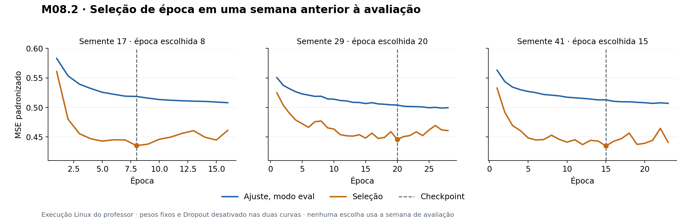

# M08.2 — de registros horários a uma rede que aprende em lotes

Marlon A. Bomfim · Renewcast · 04/11/2026

## 1. O problema que você vai resolver

O M08.1 conferiu a derivada e mostrou que minimizar a perda de ajuste não garante boa previsão. Agora mudam duas coisas: cada exemplo passa a conter uma **sequência de 24 medições disponíveis** e o estimador passa a ter uma camada não linear. A pergunta é: isso melhora a previsão h+24 em comparação com usar os mesmos 24 valores numa regressão linear?

A unidade entrega uma comparação executável, com dados reais já presentes no projeto, três sementes e checkpoints. Você aprenderá a montar exemplos temporais, implementar `Dataset`, entender o `DataLoader`, escrever uma `nn.Module`, treinar em minilotes e escolher a época sem consultar a semana de avaliação. O código normal está completo. A autoria, descrita na seção 10, é uma função de avaliação independente e um parecer sobre os resultados.

Não há meteorologia nesta comparação. Não há GPU, Spark ou Databricks em execução. O custo aqui é o treino local de uma rede de **833 parâmetros**, até 60 épocas por semente e dois threads de CPU. Essa rede é uma MLP pequena; uma GRU fica para M08.3.

## 2. Onde salvar e como executar

Baixe `renewcast_m08_2_dataset_mlp.zip` para `C:\renewable-forecast-lab` e extraia uma vez. Ele acrescenta somente arquivos desta unidade:

```text
notebooks/laboratorio_mlp.py
docs/Aula_M08_2_Dataset_MLP.md
docs/Verificacao_M08_2_Professor.json
docs/m08_2_curvas_professor.png
```

Entrada já criada no M07.3 e usada no M08.1:

```text
C:\renewable-forecast-lab\dist\databricks\CJU_BA5EIGT\m07_3\
    manifesto_entrada.json
    geracao.parquet
    treino_referencia.parquet
```

Não reinstale PyTorch: usaremos o `2.7.1+cpu` que você acabou de executar. No PowerShell:

```powershell
Set-Location C:\renewable-forecast-lab
conda activate renewable-forecast
Expand-Archive -LiteralPath .\renewcast_m08_2_dataset_mlp.zip -DestinationPath .
python notebooks/laboratorio_mlp.py
```

O programa imprime progresso por semente/época e, ao terminar, informa a pasta da execução em `reports/neural/CJU_BA5EIGT/m08_2_mlp/<execucao>`. Não procura arquivos de outros experimentos quando falta uma entrada. Uma repetição cria outra execução; não exige backup nem extrair novamente o ZIP.

| Saída | Para que serve |
| --- | --- |
| `protocol.json` | Regras fixadas antes do treino, versões de entrada e código |
| `particoes.csv` | Papel e quatro timestamps de cada origem elegível |
| `origens_sem_janela.csv` | 18 origens iniciais sem as 24 medições anteriores |
| `janelas_avaliacao.csv` | Limites e valores extremos de cada janela de avaliação |
| `curvas.csv` | Perdas por época, checkpoint escolhido e exemplos vistos |
| `summary.csv` | Persistência, linear e cada uma das três sementes da MLP |
| `predictions.csv` | Previsões pareadas nas mesmas 168 origens |
| `linear_24h.json` | Coeficientes padronizados e posto da solução de mínimos quadrados |
| `mlp_seed_17.pt`, `mlp_seed_29.pt`, `mlp_seed_41.pt` | Pesos da melhor época de seleção e escalas de cada rede |
| `resultado.json` | Fronteiras, tempo de treino, recarregamento e hashes das saídas |

## 3. Antes de pensar em camadas: o que é um exemplo?

Para uma emissão em `o`, o atraso assumido é de duas horas. A última medição utilizável é `g(o−2h)`. Uma janela de 24 valores vai de `g(o−25h)` até `g(o−2h)`, inclusive. O alvo é `g(o+24h)`; seu rótulo fica disponível em `o+26h` sob a hipótese do projeto.

Exemplo concreto da primeira origem de avaliação:

| Campo | Timestamp, no eixo sem fuso do M07 |
| --- | --- |
| Origem | 03/07/2026 04h |
| Primeiro valor da janela | 02/07/2026 03h |
| Último valor da janela | 03/07/2026 02h |
| Alvo | 04/07/2026 04h |
| Disponibilidade do alvo | 04/07/2026 06h |

Em `montar_janelas`, cada coluna é obtida com `reindex(origins - atraso)`. Não usamos “as últimas 24 linhas existentes”: se uma medição faltar, sua hora fica `NaN`. Um valor da hora anterior não pode silenciosamente ocupar o lugar da hora ausente. O laboratório exige a grade horária do pacote e exclui janelas sem valores finitos.

O tensor tem shape `[n,24,1]`: **origens × instantes dentro da janela × variável observada**. A ordem interna vai da medição mais antiga à mais recente. A última dimensão é 1 porque só há geração, não porque existe um único exemplo.

O M07 aceitava uma média de seis horas; por isso suas primeiras origens não têm 24 horas anteriores. Das 7.485 origens, **18** saem por histórico insuficiente. Isso é uma mudança explícita do contrato de entrada, não perda acidental de registros.

## 4. Três papéis temporais: ajustar, selecionar e avaliar

Escolher a melhor época olhando a última semana usaria essa semana para ajustar uma decisão do modelo. Por isso esta unidade reserva uma semana anterior para seleção. As fronteiras continuam considerando quando o rótulo fica disponível, não apenas a origem.

| Papel | Linhas | Primeira origem | Última origem |
| --- | ---: | --- | --- |
| Ajuste dos pesos e escalas | 7.079 | 02/09/2025 01h | 23/06/2026 23h |
| Seleção da época | 168 | 25/06/2026 02h | 02/07/2026 01h |
| Avaliação do checkpoint escolhido | 168 | 03/07/2026 04h | 10/07/2026 03h |
| Exclusão por disponibilidade | 52 | Dois intervalos de 26 origens | Entre os três papéis |
| Histórico inicial insuficiente | 18 | Sem janela completa de 24h | Antes dos papéis acima |

A conta fecha: `7079 + 168 + 168 + 52 + 18 = 7485`. O último rótulo de ajuste está disponível em 25/06 às 01h, antes da seleção às 02h. O último rótulo de seleção está disponível em 03/07 às 03h, antes da avaliação às 04h. Igualdade com a fronteira é excluída.

Os valores históricos usados nas features de avaliação podem incluir medições conhecidas após o início da semana: cada previsão é uma emissão horária, com sua própria informação disponível. Isso não atualiza os pesos. O modelo fica fixo; os dados de entrada evoluem. Sobreposição entre janelas consecutivas é esperada e não torna os erros independentes.

A semana de avaliação já apareceu no M08.1 e em desenvolvimento anterior. A separação protege **a escolha de época nesta execução**, mas não transforma a semana em teste final intocado. Não se deve ajustar várias configurações após vê-la e continuar tratando-a como evidência nova.

## 5. Dataset, DataLoader e padronização

Leia `JanelasDataset` primeiro. `__len__` informa quantos exemplos existem; `__getitem__(i)` devolve a janela e o alvo da origem `i`:

```python
def __getitem__(self, index):
    return self.x[index], self.y[index]
```

O `DataLoader` chama esse método para vários índices e empilha os resultados. Com lote de 128, os shapes passam de `[24,1]` e `[1]` para `[128,24,1]` e `[128,1]`. O último lote de ajuste tem **39** exemplos: `7079 = 55×128 + 39`. Na seleção/avaliação, os lotes têm **128 e 40** exemplos. `drop_last=False` preserva todos.

`shuffle=True` é aplicado somente ao loader de ajuste, depois da divisão temporal. Isso mistura a ordem das origens dentro do ajuste, sem embaralhar as 24 posições de cada janela nem mandar exemplos de avaliação para o ajuste. Uma MLP não transporta estado de uma janela para a próxima. A regra seria diferente para um treinamento recorrente que transportasse estado entre lotes. Embaralhar não remove dependência temporal dos dados nem justifica intervalos estatísticos de amostras independentes.

`num_workers=0` mantém a leitura no processo principal. Como os tensores deste recorte já estão em memória e são pequenos, adicionar processos de leitura criaria complexidade sem ganho demonstrado. Esse parâmetro não é o número de threads da multiplicação matricial; `torch.set_num_threads(2)` controla outro recurso.

Em cada uma das 24 posições, média e desvio são calculados somente nas 7.079 janelas de ajuste. A média/desvio do alvo também vêm apenas do ajuste. Seleção e avaliação reutilizam essas escalas. O alvo padronizado é adimensional; a saída retorna a MWmed antes das métricas. Este laboratório usa `float32` na rede, enquanto M08.1 usou `float64` para conferir derivadas.

## 6. O que a MLP acrescenta à regressão?

Após achatar a janela, uma regressão afim calcula:

\[
\hat z = a^T x + c.
\]

Cada hora recebe um coeficiente fixo. A MLP calcula:

\[
h=\operatorname{ReLU}(W_1x+b_1),\qquad
\hat z=W_2h+b_2.
\]

`ReLU(u)=max(0,u)`. A combinação de unidades ativas pode mudar conforme o histórico; por isso a resposta não precisa ter a mesma inclinação em todos os regimes. Sem a não linearidade, duas camadas afins em sequência ainda seriam uma única transformação afim.

| Operação | Entrada | Saída | Parâmetros |
| --- | --- | --- | ---: |
| `Flatten(start_dim=1)` | `[B,24,1]` | `[B,24]` | 0 |
| `Linear(24,32)` | `[B,24]` | `[B,32]` | `24×32+32=800` |
| `ReLU` | `[B,32]` | `[B,32]` | 0 |
| `Dropout(0.1)` | `[B,32]` | `[B,32]` | 0 |
| `Linear(32,1)` | `[B,32]` | `[B,1]` | `32+1=33` |

`start_dim=1` conserva a dimensão do lote. Achatar a partir de zero misturaria exemplos diferentes. A rede tem **833 parâmetros**, contra 25 do linear com intercepto. Mais flexibilidade permite aprender relações não lineares e também ajustar ruído; o número maior não é mérito por si só.

O linear é ajustado por `np.linalg.lstsq` nas mesmas 24 entradas e nas mesmas linhas de ajuste. Assim, uma otimização ruim de um linear treinado por poucas épocas não favorece artificialmente a rede. `linear_24h.json` registra o posto da matriz. Ele é uma referência forte e simples, não o HGB de experimentos anteriores.

## 7. Treinar em lotes e escolher um checkpoint

O laço central de `treinar` é:

```python
model.train()
for x, y in train_loader:
    optimizer.zero_grad(set_to_none=True)
    prediction = model(x)
    loss = (prediction - y).square().mean()
    loss.backward()
    optimizer.step()
```

Cada lote calcula o gradiente sobre parte das origens. Uma época percorre todas as 7.079 origens; aqui são 56 atualizações por época. O `zero_grad` continua indispensável. A atualização usa AdamW, que mantém estatísticas dos gradientes e aplica decaimento de pesos; a taxa `0.001` não pode ser interpretada pelo limite quadrático do SGD de lote completo calculado em M08.1.

Três controles têm funções diferentes:

1. **Dropout 0,1:** durante ajuste, zera aleatoriamente ativações e reescala as restantes. Na avaliação, age como identidade. Introduz perturbação no treino; não gera automaticamente intervalo de confiança.
2. **Weight decay 0,0001:** reduz pesos por atualização no AdamW. Pode ajudar a controlar a complexidade, mas seu benefício não foi isolado por uma ablação nesta unidade.
3. **Parada por seleção:** guarda a época com menor MSE de seleção e interrompe após oito épocas consecutivas sem melhora estrita, ou ao atingir 60. Empates conservam a primeira época. Os pesos guardados são uma cópia, não uma referência que muda junto com o modelo.

Para cada semente, restauramos esse checkpoint; não fazemos novo ajuste depois da seleção. O arquivo da época final de treinamento pode conter pesos piores que o checkpoint da melhor época. Essa é a razão de salvar explicitamente `best_epoch`.

Todas as sementes **17, 29 e 41** fazem parte do protocolo. Não escolhemos a melhor pela última semana. A mediana e a faixa das três descrevem sensibilidade à inicialização, às máscaras e à ordem dos lotes; não são intervalo de confiança nem uma previsão de ensemble.

## 8. Ler curvas sem confundir métricas

O CSV contém três perdas:

- `online_train_mse`: média ponderada dos erros vistos durante as atualizações. Usa pesos diferentes a cada lote e Dropout ativo; não representa uma única versão final da rede.
- `fit_eval_mse`: perda no ajuste ao fim da época, com pesos fixos e Dropout desativado.
- `selection_mse`: perda da semana de seleção com a mesma rede fixa e sem Dropout.

Compare `fit_eval_mse` e `selection_mse` para discutir evolução fora do ajuste. A seleção pode ter perda menor que o ajuste porque são regimes/períodos diferentes; a desigualdade sozinha não prova vazamento. Uma queda no ajuste acompanhada por deterioração na seleção é um sinal para investigar generalização, mas uma semana ruidosa também afeta o diagnóstico.



Esta figura é da execução do professor. O pacote não exige reproduzir seus últimos dígitos nem a mesma época em outra plataforma. As fontes/limites e os resultados estão no JSON de verificação que acompanha a aula.

Na execução de referência, usando as mesmas 168 origens:

| Método | MAE MWmed | RMSE MWmed | Viés observado − previsto MWmed |
| --- | ---: | ---: | ---: |
| Persistência d2 | 37,991646 | 55,434342 | −3,016872 |
| Linear 24h | 33,678664 | 44,938111 | +15,148681 |
| MLP, semente 17 | 32,724828 | 44,019866 | +10,655947 |
| MLP, semente 29 | 33,700811 | 44,892316 | +12,652756 |
| MLP, semente 41 | 33,159788 | 44,069511 | +13,724279 |

O linear já captura boa parte do ganho sobre persistência. As MLPs não vencem o linear em todas as sementes; a diferença da semente 29 é pequena e desfavorável. O viés continua positivo nas redes. A persistência tem menor viés absoluto, mas maior MAE/RMSE: neutralidade média não implica pequenos erros individuais.

Não compare a melhora desta tabela contra o afim de duas features do M08.1 como se somente a arquitetura tivesse mudado: também mudaram entradas, quantidade de ajuste e seleção. A comparação controlada para esta pergunta é **linear 24h versus MLP 24h dentro desta execução**.

## 9. Por que `eval()` e `no_grad()` são dois comandos?

`model.eval()` muda o comportamento de módulos como Dropout. Ele não desativa o cálculo de gradientes. `torch.no_grad()` desativa a construção do grafo dessas operações, mas não desliga Dropout. Uma avaliação comum precisa dos dois.

O avaliador restaura o modo anterior ao sair. Isso evita que uma avaliação intercalada deixe, por acidente, o treino seguinte com Dropout desligado. A função não chama `backward`, `step` ou `zero_grad`: calcular uma métrica não deve modificar pesos nem gradientes existentes.

Também precisamos combinar lotes corretamente. Considere quatro exemplos com erro zero e um último exemplo com erro 10. Os MSEs dos lotes são 0 e 100. A média simples dos dois MSEs é **50**, mas o MSE dos cinco exemplos é **20**:

\[
\operatorname{MSE}=\frac{\sum_b\sum_{i\in b}(\hat y_i-y_i)^2}{\sum_b n_b}
=\frac{4\cdot0+1\cdot100}{5}=20.
\]

Esse erro pode mudar qual época parece melhor. Não é detalhe cosmético de relatório.

## 10. Sua demanda de programação e análise

**Arquivo a criar:** `C:\renewable-forecast-lab\notebooks\m08_avaliacao_autoral.py`.

Implemente uma função `avaliar_lotes(modelo, loader)` com o seguinte contrato:

- O loader entrega pares `(x, y)`, com `y [B,1]`; previsão deve ter o mesmo shape.
- Use `eval()` e contexto sem gradientes; preserve o modo em que o modelo entrou, inclusive se ocorrer erro.
- Percorra os lotes; some os erros quadráticos e conte exemplos. Converta o resíduo para `float64` antes de somar, para a conferência numérica.
- Devolva exatamente `{"rows": total_de_exemplos, "mse": soma_dos_quadrados / total_de_exemplos}`.
- Não faça média simples dos MSEs dos lotes, não descarte o lote final e não acumule todos os tensores numa lista.
- Rejeite loader vazio com `ValueError`. Rejeite shapes divergentes e erros não finitos. Não altere parâmetros nem gradientes existentes.

Você pode consultar a referência `avaliar_lotes_referencia` para aprender, mas descreva a ajuda utilizada. A concordância não será rotulada como autoria independente automaticamente. O objetivo é conseguir explicar o algoritmo e diagnosticar o caso 4+1.

Execute após escrever a função:

```powershell
python notebooks/laboratorio_mlp.py --autoria notebooks/m08_avaliacao_autoral.py
```

O modo autoral confere primeiro o caso de cinco exemplos, `eval/no_grad`, preservação de modo/pesos/gradientes e loader vazio. Depois **usa sua função na seleção de épocas da rede**, mantendo o protocolo. Essa execução gera outra pasta; a execução de referência permanece disponível. O comando normal não depende deste arquivo.

**Parecer a escrever:** `C:\renewable-forecast-lab\reports\parecer_m08_mlp.md`, entre 400 e 700 palavras, respondendo com números da sua execução:

1. Reconstrua uma janela real com origem, primeiro/último instante, alvo e disponibilidade. Explique por que `shuffle=True` no ajuste não permite embaralhar a divisão temporal.
2. Informe a melhor época e a época de parada de cada semente. Use as duas curvas determinísticas para discutir o que ocorreu depois da melhor época.
3. Compare as três MLPs com o linear nas mesmas origens. Explique por que não escolher apenas a melhor semente da semana de avaliação.
4. Defenda uma decisão: manter a MLP como candidata, preferir o linear por enquanto ou considerar a evidência inconclusiva. Inclua viés, variação entre sementes e custo de treinamento. Ganhar no MAE desta semana não é aprovação operacional.

Para revisão, envie o código da função, o parecer e `resultado.json`, `summary.csv` e `curvas.csv` da execução autoral. Não precisa enviar pesos, refazer M07 ou rodar novamente M08.1.

## 11. Limites e continuidade

A verificação local mede o comportamento deste recorte, nesta divisão e nestas sementes. A memória registrada é somente a do tensor de entrada de ajuste, não pico do processo. Os tempos variam por máquina e não são um benchmark de plataforma. Seeds e algoritmos determinísticos não garantem igualdade bit a bit entre plataformas/versões.

Preservamos as hipóteses do M07: eixo de timestamps sem fuso físico validado e atraso assumido. O hash é verificado contra o manifesto da própria entrada; não se exige que a serialização Windows tenha o hash do arquivo Linux do professor.

O professor usou o pacote local de conferência derivado dos dados que o aluno forneceu nas etapas anteriores. A geração desse pacote foi reconstruída de campos consistentes da tabela temporal recebida; não é uma nova coleta ONS nem uma auditoria do arquivo bruto original. Não atribua os resultados Linux à sua execução Windows antes de rodá-la.

M08.3 reaproveitará o contrato `[B,tempo,variáveis]` para uma arquitetura temporal, como GRU, e uma comparação sob protocolo alinhado. Não será necessário reconstruir a infraestrutura de dados para avançar.

Referências oficiais consultadas em 04/11/2026: [Dataset e DataLoader, PyTorch 2.7](https://docs.pytorch.org/docs/2.7/data.html), [nn.Module](https://docs.pytorch.org/docs/2.7/generated/torch.nn.Module.html), [Dropout](https://docs.pytorch.org/docs/2.7/generated/torch.nn.Dropout.html), [reprodutibilidade](https://docs.pytorch.org/docs/2.7/notes/randomness.html). As decisões experimentais e os números acima vêm do protocolo e da execução fornecidos, não dessas páginas.
