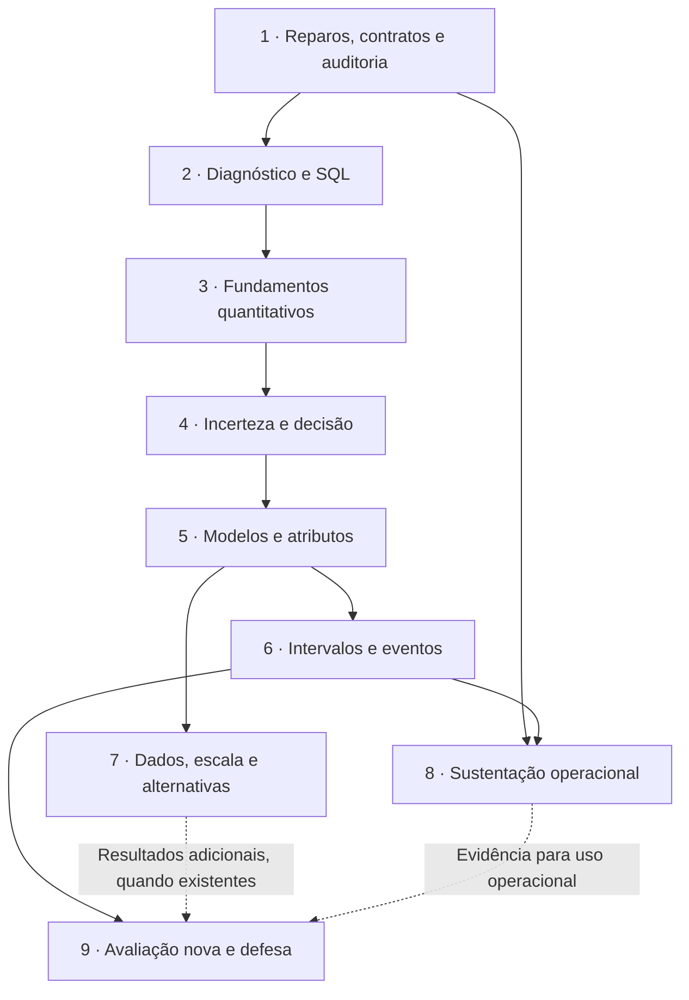

# Roadmap de fechamento M00–M09

26/11/2026 · Renewcast/P1 · revisão local 5 — entrega de engenharia

Este plano incorpora a retomada dos módulos iniciais ao projeto. O escopo inclui M00, porque consta na lista recebida, e M01–M09. Ele organiza **45 itens de fechamento em nove etapas**. Esses itens são um backlog de pendências e não as 48 unidades da formação, uma estimativa de horas ou um percentual de domínio.

**Agrupamento de execução aprovado:** bloco 1 = etapas 1–3; bloco 2 = etapas 4–6; bloco 3 = etapas 7–9. O [bloco 1 está concluído no aceite de engenharia](roadmap_m00_m09/Bloco_1_Execucao.md): 14 itens aplicados validados, sem exercícios do usuário pendentes. O [bloco 2](roadmap_m00_m09/Bloco_2_Execucao.md) acrescenta nove entregas executadas e analisadas. O [bloco 3 foi executado no alcance local](roadmap_m00_m09/Bloco_3_Execucao.md): 12 IDs integralmente demonstrados e seis operacionais abertos, três com aceite técnico parcial. Quatro comprovações externas M04 anteriores continuam bloqueadas. Os 45 IDs foram preservados: 35 validados no escopo declarado e 10 bloqueados; não é percentual da formação nem autorização operacional.

**Modo esclarecido pelo usuário:** aplicar correções e análises e explicá-las minuciosamente, sem atuar como professor. As antigas provas/defesas independentes são histórico de formação; para esta entrega, foram substituídas por soluções técnicas fornecidas e executadas, sem certificar autonomia pessoal. Os critérios e o cadastro anteriores foram preservados. Use `--bloco 1 --gate engenharia` para o aceite aplicado; `--exigir-fechamento` irrestrito também exige os quatro pontos operacionais. O [relatório de engenharia](roadmap_m00_m09/Relatorio_Engenharia_Bloco1.md) é a referência atual.

O [cadastro executável](../config/roadmap_m00_m09.json) guarda IDs, dependências, entregáveis, critérios e estado. Este documento explica a rota. O [roteiro didático local](Roteiro_Auditavel_Data_Science.md) é a versão 1.66, de 17/11/2026; conserva a história e os aceites daquela data. As versões posteriores mencionadas na conversa não foram localizadas nesse arquivo. A reconciliação não fabrica uma versão 1.72 nem um novo aceite do professor.

**Execução do bloco 2:** bootstrap horário aplicado às previsões preservadas; custos recalculados; oito candidatos e grupos de atributos comparados em validação temporal; Shapley local exato; quantis/CQR, Platt, política causal e rampa de uma hora avaliados em 695 origens de outubro. O snapshot foi obtido depois do congelamento do código/modelos/política, mas é uma avaliação histórica, não shadow prospectivo. O HGB perdeu da persistência em MAE, o CQR ficou sobrecoberto, a política congelada não foi a melhor no teste e o detector horário perdeu 39 eventos. O [relatório aplicado](roadmap_m00_m09/Relatorio_Engenharia_Bloco2.md) preserva esses resultados sem reajustar o teste. A migração dos requisitos prospectivos para M06-05 preserva os 45 IDs, seus históricos e o portão operacional aberto.

**Execução do bloco 3:** camadas/incremento/escala local e modelo global executados; LightGBM/CatBoost selecionados no desenvolvimento; adaptações GRU/Transformer conferidas; MLflow Registry real com rollback; serviço protegido/carga/replay/drift testados. Na avaliação congelada de setembro (671 origens), a persistência teve menor MAE que as alternativas, e o candidato HGB não atingiu o critério de ganho. Os resultados estão no [relatório final](roadmap_m00_m09/Relatorio_Engenharia_Bloco3.md). M06-04/05/06/07/08/09 mantêm operação aberta; segurança/capacidade continuam antes do shadow e drift depende da continuidade. Os requisitos não foram transferidos para contornar dependências. O CI passou nas duas rodadas remotas controladas, com revisão própria; o plano cloud continua sem implantação. A main não foi alterada.

## Diagnóstico que originou a retomada — 24/11/2026

Os pontos abaixo conservam o diagnóstico inicial. O estado posterior dos reparos e auditorias está no [registro do bloco 1](roadmap_m00_m09/Bloco_1_Execucao.md) e no cadastro; não interpretar os problemas iniciais como reparos ainda não executados.

- **E51 continua pendente no código:** `validate_wind_geometry`, em [weather_artifact.py](../src/renewable_forecast/weather_artifact.py), ainda seleciona campos por substring e ordem.
- **O bootstrap horário local está incompleto:** [weather_gain_uncertainty.py](../src/renewable_forecast/weather_gain_uncertainty.py) termina `summarize` em `rows = []`. E42/E47 registram experimentos históricos; eles não demonstram que esse arquivo atual esteja reproduzível. Recuperar o código e executar o experimento são tarefas diferentes.
- **Os brutos M08 e M09.2 existem agora no disco.** A revisão antiga dizia que não haviam sido anexados. Isso exige auditoria dos arquivos encontrados, sem presumir nova execução ou autoria independente. A [conferência pontual](roadmap_m00_m09/auditoria_m08_m09.json) registra o alcance da inspeção local.
- **A conferência pontual encontrou saídas preservadas e código atual diferente:** em 12 execuções fixadas, as 115 declarações de saídas têm hashes coincidentes. Três arquivos atuais diferem dos recibos históricos: o gradiente M08.1 e o runner/verificador M09.2. As diferenças não são explicadas pelas variantes de BOM/quebra de linha conferidas. Reconciliar essas versões continua pendente; igualdade das saídas históricas não torna o código atual idêntico ao executado.
- **O parecer integrado M09.3 já existe:** [parecer_m09_pre_treinado.md](../reports/parecer_m09_pre_treinado.md). Falta a avaliação da defesa própria e da transferência; não criar outro parecer como se o primeiro não existisse.
- **O parecer M07.3 conservava afirmações já corrigidas em E108.** Esta retomada reconcilia [scale_comparison.md](../reports/scale_comparison.md), sem repetir Spark ou Databricks. Explicar o plano de forma independente permanece uma avaliação distinta.
- **Há uma inconsistência de acesso/inventário no registro M06.** O status Git mostra arquivos como removidos e a leitura de versões encontra acesso negado. Ainda não foi isolado se há perda, restrição ou outra causa. Nenhum arquivo foi restaurado nem substituído nesta retomada.
- **M10 e M11 já avançaram além do painel antigo.** Há entregas locais M10.1–M10.4 e a execução M11.2 `20261125T000415Z_b376eb6f`. Este roadmap retoma M00–M09; não reabre essas unidades nem declara M11 completo.

A ausência de um arquivo numa busca local significa “não localizado nesta revisão”. Não demonstra que o trabalho nunca existiu. Código, execução, integridade, compreensão e validade operacional são evidências diferentes.

## Mapa de escopo por módulo

Esta tabela identifica o conteúdo coberto pela retomada. O estado atual vem do cadastro. No modo aplicado, referências antigas a defesa/transferência significam análise e adaptação técnica fornecidas, sem exigir prova do usuário.

| Módulo | Trabalho reconhecido | Fechamento a construir ou validar | Itens |
| --- | --- | --- | --- |
| M00 | Ambiente, fluxo Python e contratos usados | Documentação do percurso e análise da adaptação temporal | M00-01 |
| M01 | ONS, Parquet, qualidade e SQL; LAG corrigido | Análise de granularidade/janelas e aplicação a outro recorte; data card | M01-01–02 |
| M02 | Resíduos, métricas, gradiente e comparações; bootstrap histórico registrado | Probabilidade, distribuições, estimação, hipóteses, regressão/pressupostos; recuperar bootstrap, executá-lo e interpretar; revisar perda/decisão e prova nova | M02-01–08 |
| M03 | Baselines, Ridge/HGB, tuning temporal, holdout e ablações | Model card, defesa, explicação local ou SHAP conforme a pergunta, seleção sistemática e avaliação futura congelada | M03-01–04 |
| M04 | Meteorologia, as-of, horizontes e inferência por artefato | E51; comprovar fuso/intervalo, disponibilidade histórica e cadastro; fechar contrato point-in-time operacional | M04-01–05 |
| M05 | Quantis, CQR, eventos, custos e seleção sob capacidade | Estabilidade futura, calibração de probabilidade de classe, alvo horário distinto; comparação LightGBM/CatBoost e global multissérie na ampliação | M05-01–05 |
| M06 | API, lote, Docker, telemetria exercitada, registro/rollback local e cliente Windows | Reconciliar registro; CI remoto, MLflow Registry, shadow, continuidade, drift, segurança/custos; cloud na ampliação | M06-01–09 |
| M07 | Spark/Delta/Databricks e equivalência do recorte | Corrigir/defender interpretação; construir bronze/silver/gold; medir escala e operar multissérie na ampliação | M07-01–04 |
| M08 | Autograd, MLP, GRU e implementações aceitas | Auditar brutos localizados; defesa GRU/HGB e adaptação independente | M08-01–03 |
| M09 | Atenção, composição Transformer e Chronos comparado | Auditar M09.2; transferência própria; delimitar sobreposição de pré-treino; defesa integrada apoiada em período novo | M09-01–04 |

Não há exigência de refazer LSTM: a GRU já atende à família temporal prevista. A explicação local pode usar método equivalente ao SHAP quando responder à pergunta e tiver suas limitações verificadas. A ablação história versus história+vento não substitui automaticamente seleção individual de atributos.

## Nove etapas de execução, construção e aplicação

A ordem abaixo é uma rota por dependências. Não é um calendário. Tarefas de documentação de fonte, CI e preparação de ambiente podem avançar em paralelo. Uma hipótese externa ainda não confirmada impede a alegação operacional correspondente; não impede estudar estatística no recorte sob hipóteses declaradas.

| Etapa | Construção e execução | Aplicação e evidência de saída | Condição para passar |
| --- | --- | --- | --- |
| **1. Sanear código, contratos e evidências** | Recuperar bootstrap; corrigir E51; inventariar registro; auditar M08/M09.2; investigar contratos M04 e pré-treino | Contraprovas pequenas, inventários, fontes e recibos separados dos runs aceitos | Reparos demonstrados e limites conhecidos. Sem transformar ausência de fonte em confirmação |
| **2. Consolidar diagnóstico e SQL** | Explicar fluxo, JOIN/nulos/LAG e plano Spark; aplicar SQL em outro mês | Documentação, consultas, soluções aplicadas e reconciliação | Saída reconciliada, granularidade e disponibilidade explicadas |
| **3. Fechar fundamentos M02** | Probabilidade/distribuições → estimação → hipóteses; regressão matemática e pressupostos | Contas analíticas, código e diagnósticos reproduzíveis | Resultados conferidos no caso fixado; hipóteses e efeito definidos antes do cálculo |
| **4. Quantificar incerteza e decisão** | Executar bootstrap recuperado sobre previsões salvas; revisar perdas/custos; prova estatística nova | Sensibilidade a blocos, estimando, intervalos e justificativa de decisão | Distinguir incerteza condicional, efeito prático e generalização; nenhum novo ajuste do benchmark antigo |
| **5. Defender e selecionar modelos/atributos** | Model card, explicação local e seleção por grupos dentro da validação temporal | Ranking de candidatos no desenvolvimento, origem das features e explicações limitadas à evidência | Escolha congelada e teste ainda intocado; importância não tratada como causa |
| **6. Validar incerteza e eventos futuros** | Separar calibração de intervalos da de probabilidades; definir rampas de uma hora | Cobertura/largura/perdas, Brier/confiabilidade, alarmes e contrato do novo alvo | Cortes e critérios prévios; não recalibrar no período usado para avaliar |
| **7. Ampliar dados e alternativas** | Bronze/silver/gold, LightGBM/CatBoost, pipeline multissérie, modelo global e escala medida | Linhagem, idempotência, métricas por série, recursos e plano final | Mesmas coortes e orçamento; declarar ampliação sintética. Ganho positivo não é requisito de aceite |
| **8. Construir sustentação operacional** | CI remoto e registro → shadow → monitoramento/drift; segurança, capacidade e custos; cloud delimitada se executada | URLs/commits, versões, telemetria contínua, incidentes, rollback e custo observado | Contratos M04 sustentados, orçamento definido e evidência real do ambiente. Template/replay não encerra operação |
| **9. Avaliar e justificar a aplicação** | Usar modelo congelado em período novo e analisar GRU/HGB/Chronos; adaptação neural/Transformer | Comparação pareada de erro, viés, intervalos e custo; justificativa técnica e limites | Avaliação registrada, execução atribuída corretamente e decisão proporcional ao resultado |

As etapas 7 e 8 contêm trilhas paralelas: o núcleo formativo não depende de contratar cloud ou de treinar todas as bibliotecas. Todas essas pendências continuam no cadastro, com portões próprios.



## Primeira rodada concreta

1. **M04-01:** substituir a busca por substring pelos nomes exatos, sem mudar o estimador. Conferir pedido real, ordem invertida, velocidade negativa, componentes negativas válidas e o caso impossível velocidade 12/u 30/v 0.
2. **M02-05:** procurar versão preservada do bootstrap; recuperar ou completar retorno/CLI com proveniência. Conferir pareamento, circularidade e determinismo em dados pequenos. O bootstrap completo dos dados salvos é **M02-08**, depois dos fundamentos necessários.
3. **M08-01 e M09-01:** reconciliar recibos e hashes dos arquivos já encontrados; isolar faltas, código alterado depois do run e arquivos inacessíveis. Repetir só uma verificação necessária se a evidência não puder ser recuperada.
4. **M06-01:** explicar o estado do registro antes de restaurar qualquer coisa.
5. Fornecer as soluções técnicas M00/M01/M02/M07, executar as contas e reconciliar os resultados. As soluções aplicadas foram entregues no bloco 1 e são atribuídas ao trabalho técnico, sem exigir respostas do usuário nem certificar autoria independente.

Os reparos E51/bootstrap e as soluções aplicadas desta rodada foram executados em 25/11/2026, com recibos e revisão técnica. Não há prova do usuário exigida para o aceite de engenharia. As fontes externas ainda limitam a homologação operacional; não houve reexecução de treinos aceitos.

## Entregáveis e critério de fechamento

Cada ID tem destinos concretos no cadastro. A pasta padrão de uma nova entrega é:

```text
reports/fechamento_m00_m09/<ID>/
    protocolo.json    # recorte, hipóteses, critérios e ordem antes da avaliação
    resultado.json    # execução, versões, entradas/saídas e hashes
    parecer.md        # interpretação e revisão atribuída a quem a realizou
    ...               # CSV, contraprovas ou resposta exigidos naquele item
```

Os destinos acima são **planejados**, não arquivos já executados. Não renomear runs antigos nem criar recibos retroativos. O parecer inclui responsável/data, decisão e limites; para marcar `validado`, ele precisa de hash registrado. O cadastro admite parecer de revisão separado se o item exigir. O receipt de um caso novo declara o período, o corte de ajuste/seleção/avaliação, o código e as fontes usados.

Estados: `planejado` → `em_execucao` → `aguarda_revisao` → `validado`; `bloqueado` registra motivo e condição de desbloqueio. Uma revisão pode devolver o item para trabalho sem apagar seu histórico.

Um item só passa a `validado` com:

- todos os critérios explicitamente atendidos;
- entregáveis existentes e registrados com SHA-256;
- parecer aprovado, responsável e data;
- dependências validadas;
- evidência compatível com a alegação: revisão documental, resposta independente ou operação real, conforme o item.

Código e análise técnica não certificam autonomia pessoal; essa certificação não é exigida na entrega aplicada. Um template de CI não prova execução remota. `approved_for_shadow` num relatório estatístico não prova que o shadow foi operado. MLflow Tracking e registro SQLite não equivalem ao Model Registry.

## Aplicar a regra no projeto

As [instruções do repositório](../AGENTS.md) passam a exigir consulta ao cadastro nas tarefas M00–M09 e preservação dos aceites. O [verificador local](../scripts/verificar_roadmap.py) usa apenas a biblioteca padrão:

```powershell
# Conferir cadastro, dependências e evidências, mantendo pendências explícitas.
python scripts/verificar_roadmap.py

# Acompanhar o bloco ativo, sem perder a validação estrutural global.
python scripts/verificar_roadmap.py --bloco 1
python scripts/verificar_roadmap.py --bloco 1 --gate engenharia
python scripts/verificar_roadmap.py --bloco 1 --exigir-fechamento
python scripts/verificar_roadmap.py --bloco 2 --gate engenharia
python scripts/verificar_roadmap.py --bloco 3 --gate engenharia

# Gerar um retrato local do estado sem alterar o cadastro.
python scripts/verificar_roadmap.py --output docs/roadmap_m00_m09/estado_atual.json

# Antes de declarar encerramento, exigir o portão correspondente.
python scripts/verificar_roadmap.py --gate formacao
python scripts/verificar_roadmap.py --gate operacao
python scripts/verificar_roadmap.py --gate ampliacao
```

O modo normal retorna zero para um backlog coerente ainda aberto. Um portão com pendências retorna código 1. **Isso é o comportamento esperado, não uma falha do laboratório.** Nenhum desses comandos treina, acessa nuvem, publica ou implanta o serviço.

- **Engenharia:** código, análises e explicações aplicadas, sem exercícios obrigatórios do usuário.
- **Formação:** registro histórico de competências; não é o aceite solicitado nesta entrega.
- **Operação:** evidências exigidas neste plano para avaliar uso operacional do P1. Aprovação do cadastro não é autorização de produção nem substitui aceite do responsável.
- **Ampliação:** LightGBM/CatBoost, global/multissérie, escala ampliada e cloud. A separação é explícita; esses itens não desaparecem do escopo.

O verificador detecta cadastro inválido, ciclos, ausência de entrega/revisão e divergências de hash. **Ele verifica consistência documental; não decide se uma explicação é correta, se uma pessoa aprendeu ou se o serviço operou de fato.** Não foi instalado um bloqueio de push. O [workflow M06-02](../.github/workflows/bloco3-contratos.yml) foi executado e validado nos commits registrados na [revisão do CI remoto](roadmap_m00_m09/Revisao_CI_Remoto_Bloco3.md), sem merge ou deploy. Ele cobre os contratos selecionados do bloco 3; o verificador completo do roadmap permanece local e não integra esse workflow.

Para atualizar: identificar o ID, registrar execução/revisão real, atualizar critérios e hashes, executar a verificação e revisar o diff. Não marcar critérios como atendidos apenas porque esta rota foi escrita.
