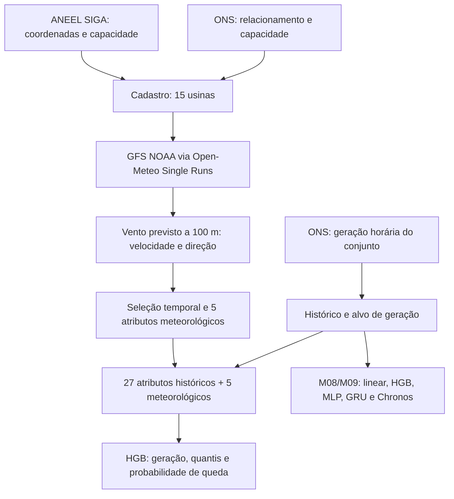

# De onde vêm os dados e as previsões do Renewcast

25/11/2026. Rastreabilidade preparada com assistência Codex a partir de arquivos existentes e documentação primária. Esta entrega explica a engenharia do projeto; não atribui uma resposta independente ao usuário, altera aceites ou encerra pendências operacionais. Foram consultados o roteiro, o cadastro e o plano do bloco 1. Os itens relacionados são M04-02, M04-03, M04-04, M04-05 e M09-03.

A resposta direta é: **o Renewcast usa a geração histórica publicada pelo ONS como histórico e alvo. Nos estudos meteorológicos, também usa previsões de vento do GFS/NOAA, obtidas pelo Open-Meteo. A previsão de geração em MWmed é produzida pelos modelos executados no projeto.** Há experimentos que usam as duas entradas e outros que usam somente geração histórica.



## 1. O que foi recebido do ONS

O ponto de partida é o [portal Geração por Usina em Base Horária](https://dados.ons.org.br/dataset/geracao-usina-2). O projeto conserva **12 arquivos mensais Parquet, de setembro de 2025 a agosto de 2026**, em `data/raw/GERACAO_USINA-2_*.parquet`. A preparação filtra `id_ons = CJU_BA5EIGT`, mantém as referências horárias e materializa [a série local](../../data/interim/CJU_BA5EIGT_hourly.parquet): **8.760 linhas, de 01/09/2025 00h a 31/08/2026 23h**. A modalidade registrada nas linhas é `Conjunto de Usinas`; a entidade é o conjunto Igaporã III 500 kV, na Bahia. Não é a medição individual das 15 usinas do cadastro.

O código [data_contract.py](../../src/renewable_forecast/data_contract.py) lê os arquivos, converte `val_geracao` para número, seleciona o identificador e verifica ausência de dados, duplicações e lacunas. A série já vem em resolução horária: essa etapa não cria medições ou converte vento em geração. O [dicionário ONS](https://ons-aws-prod-opendata.s3.amazonaws.com/dataset/geracao_usina_2_ho/DicionarioDados_GeracaoPorUsina.pdf) descreve a unidade MWmed e a referência `din_instante`. MWmed é potência média no intervalo; uma média de 1 MW durante uma hora corresponde a 1 MWh de energia.

O arquivo [geracao.parquet do M07.3](../../dist/databricks/CJU_BA5EIGT/m07_3/geracao.parquet) é outra representação congelada dessas 8.760 referências, reutilizada pelas aulas M08/M09. Seu manifesto registra também 7.485 linhas de treino de referência. A diferença de hash entre representações não demonstra diferença nos valores: serializações distintas podem conter a mesma série. O manifesto desta entrega registra separadamente a identidade de cada arquivo.

**Ressalva do portal:** a descrição ONS informa que certos grupos de pequenas usinas Tipo III sem relacionamento com o ONS referem-se a previsões de geração. Portanto, não se deve afirmar que todo registro desse dataset é uma medição observada. O recorte local está identificado como conjunto e é tratado pelos experimentos como histórico de geração; a ressalva geral não comprova que o ONS forneça a previsão individual utilizada pelos modelos Renewcast. O portal também informa que os dados podem ser atualizados após a publicação. A cópia local preservada não prova qual versão estava publicada em cada origem histórica.

## 2. Como as usinas e as coordenadas foram identificadas

O [cadastro local](../../data/reference/CJU_BA5EIGT/asset_registry.csv) combina três fontes oficiais, cujos endereços, horários de coleta e hashes constam em [metadata.json](../../data/reference/CJU_BA5EIGT/metadata.json):

| Fonte | Papel no projeto |
| --- | --- |
| [Relacionamento usina–conjunto do ONS](https://ons-aws-prod-opendata.s3.amazonaws.com/dataset/usina_conjunto/RELACIONAMENTO_USINA_CONJUNTO.csv) | Identificar as usinas relacionadas ao conjunto |
| [Capacidade de geração do ONS](https://ons-aws-prod-opendata.s3.amazonaws.com/dataset/capacidade-geracao/CAPACIDADE_GERACAO.csv) | Agregar a capacidade das unidades por usina |
| [SIGA/ANEEL](https://dadosabertos.aneel.gov.br/dataset/6d90b77c-c5f5-4d81-bdec-7bc619494bb9/resource/2f65a1b0-19b8-4360-8238-b34ab4693d55/download/siga-empreendimentos-geracao-diario.csv) | Obter localização cadastrada e conferir capacidade pelo CEG |

As cópias foram coletadas em **22/09/2026**. A seleção declara pertencimento em 01/09/2026 e produz **15 usinas, 27 registros de capacidade e 227,7 MW**. O total ONS coincide com o ANEEL no cadastro gerado, com diferença máxima por usina de 0 MW. A transformação agrega capacidade antes da junção para evitar multiplicar linhas, normaliza o formato do CEG sem substituir a identificação por semelhança de nomes, converte kW em MW e coordenadas para números. O código está em [asset_registry.py](../../src/renewable_forecast/asset_registry.py).

As coordenadas são localizações cadastrais das usinas, não de cada aerogerador. O peso espacial é a capacidade ONS da usina dividida por 227,7 MW. O cadastro declara `historical_snapshot_verified=false`: a coleta de setembro não comprova que localização, capacidade e associação fossem exatamente as mesmas e conhecidas em julho. Esse limite permanece em M04-04.

## 3. De onde vem a previsão do vento

O modelo meteorológico é o [GFS, do NOAA/NCEP](https://www.emc.ncep.noaa.gov/emc/pages/numerical_forecast_systems/gfs.php). O projeto o acessa pelo arquivo de rodadas [Open-Meteo Single Runs](https://open-meteo.com/en/docs/single-runs-api), que identifica a previsão pela inicialização da rodada. Não é uma consulta ao valor observado do vento e não é uma previsão de geração fornecida pelo ONS.

O endpoint exato implementado em [weather_runs.py](../../src/renewable_forecast/weather_runs.py) é:

```text
https://single-runs-api.open-meteo.com/v1/forecast
```

| Parâmetro | Valor preservado na consulta de referência |
| --- | --- |
| `models` | `gfs_global` |
| `hourly` | `wind_speed_100m,wind_direction_100m` |
| `wind_speed_unit` | `ms`, resposta em m/s |
| Direção | Graus na resposta |
| `timezone` | `UTC` |
| `run` | `2026-07-01T00:00` |
| `forecast_hours` | `48` |
| `latitude`, `longitude` | 15 pares cadastrais; os valores exatos estão no recibo |
| `cell_selection` | `nearest` |
| `elevation` | 15 valores `nan`, para desativar ajuste por elevação |

O [recibo da consulta](../../data/external/weather/CJU_BA5EIGT/gfs_20260701T0000Z/metadata.json) preserva a URL completa, parâmetros, status HTTP 200, coleta em **28/09/2026 22:37:41 UTC**, bytes e SHA-256 da resposta. Os arquivos [response.json](../../data/external/weather/CJU_BA5EIGT/gfs_20260701T0000Z/response.json), [weather_forecasts.csv](../../data/external/weather/CJU_BA5EIGT/gfs_20260701T0000Z/weather_forecasts.csv) e [grid_mapping.csv](../../data/external/weather/CJU_BA5EIGT/gfs_20260701T0000Z/grid_mapping.csv) permitem rastrear o conteúdo bruto, a normalização e o ponto de grade escolhido.

Cada rodada contém **48 horas × 15 localizações = 720 linhas normalizadas**. As 15 localizações caem em **cinco células de grade distintas**, com 1, 1, 1, 7 e 5 usinas. Isso representa a resolução espacial disponível; não são 15 previsões meteorológicas independentes. Os pesos das cinco células estão em [grid_weights.csv](../../data/reference/CJU_BA5EIGT/grid_weights.csv).

Foram localizadas **126 rodadas em cache**, e os 126 hashes das respostas foram novamente confrontados com os recibos nesta inspeção, sem divergências. O inventário pré-existente [M04-03](../../reports/fechamento_m00_m09/M04-03/resultado.json) registra 90.720 linhas normalizadas e 124 rodadas usadas no recorte h24 de julho. Os hashes dos demais artefatos selecionados estão no [manifesto desta entrega](../../reports/fechamento_m00_m09/bloco1_engenharia/fontes_manifesto.json).

São quatro relógios diferentes: inicialização da rodada (`run_time`), hora prevista (`valid_time`), momento assumido de disponibilidade (`available_at`) e coleta efetivamente registrada (`fetched_at`). No cache, `available_at = run_time + 6 horas` é uma hipótese. **Há zero horários de publicação histórica observados no inventário.** Coletar uma rodada de julho em setembro não comprova que ela estivesse disponível antes da decisão de julho; também não comprova que estivesse indisponível. O estado é desconhecido. Esta entrega não fez nenhuma nova consulta de previsão.

## 4. Como vento e geração entram no modelo

Para uma origem de previsão e horizonte de 24 horas, [weather_asof.py](../../src/renewable_forecast/weather_asof.py) seleciona o vento cujo `valid_time` é a origem mais 24 horas. Entre rodadas com disponibilidade assumida menor ou igual à origem, escolhe a mais recente. A junção preserva as origens, inclusive quando falta meteorologia. Essa regra evita escolher deliberadamente uma rodada posterior sob o contrato declarado; não transforma a latência assumida em disponibilidade comprovada.

[weather_features.py](../../src/renewable_forecast/weather_features.py) resume as 15 localizações com os pesos de capacidade: média da velocidade, desvio espacial, componentes médias `u` e `v` e média do cubo da velocidade. As componentes usam `u = -velocidade × sen(direção)` e `v = -velocidade × cos(direção)`. A média do cubo da velocidade é um atributo meteorológico em m³/s³; **não é potência elétrica em MW**. Não há aqui uma curva de potência individual de cada turbina.

O [frame de modelagem](../../data/interim/modeling/CJU_BA5EIGT/h24_d2_july_development/model_frame.csv) tem **744 origens completas e 32 atributos: 27 históricos e cinco meteorológicos**. Os históricos incluem lags de geração, médias e desvios móveis, calendário cíclico e variação recente. [weather_training.py](../../src/renewable_forecast/weather_training.py) combina as fontes pela origem e pela hora alvo. O alvo é a geração ONS futura, usada para aprender ou avaliar a relação; ele não é um atributo fornecido à emissão da previsão.

O protocolo assume atraso de duas horas para geração e interpreta seus rótulos locais em `America/Sao_Paulo`, convertendo o alinhamento para UTC. O fuso físico e a posição do rótulo em relação ao início/fim do intervalo não foram confirmados. O calendário local e a junção em UTC são escolhas implementadas, cuja validação física permanece em M04-02/M04-05.

## 5. Onde estão as previsões produzidas

Todos os caminhos abaixo apontam para resultados históricos existentes. Não são previsões atuais nem novas execuções desta entrega.

| Produto | Arquivo | Usa vento previsto? |
| --- | --- | --- |
| Ponto h6, geração em MWmed | [forecast_20260901T010000.json](../../reports/forecasts/h6_d2/d401657267524b528120f2c0ca7ea184/forecast_20260901T010000.json) | Não; histórico de geração |
| Ponto h24, replay histórico | [prediction.json](../../reports/inference/CJU_BA5EIGT/h24_replay_20260801T0500Z/prediction.json) | Sim; histórico + GFS |
| Comparação persistência/HGB histórico/HGB com vento | [predictions.csv](../../reports/weather_ablation/CJU_BA5EIGT/july_development_h24/predictions.csv) | O braço `hgb_history_weather` usa; os outros não |
| Quantis de geração p10/p50/p90 | [predictions.csv dos quantis](../../reports/probabilistic/CJU_BA5EIGT/h24_d2_july_quantiles_v1/predictions.csv) | Sim no HGB; referência por resíduos de persistência não |
| Intervalos ajustados por CQR | [predictions.csv da calibração](../../reports/probabilistic/CJU_BA5EIGT/h24_d2_july_calibration_v1/predictions.csv) | Sim |
| Probabilidade de queda `p_event` | [predictions.csv dos eventos](../../reports/events/CJU_BA5EIGT/h24_d2_july_drop22p77_v1/predictions.csv) | Sim nos classificadores; frequência histórica não |
| Pontos M08.3: persistência, linear, HGB, MLP e GRU | [predictions.csv M08.3](../../reports/neural/CJU_BA5EIGT/m08_3_gru/20261115T170309Z_90a6625f/predictions.csv) | Não |
| Pontos e quantis M09.3: Chronos e referências preservadas | [predictions.csv M09.3](../../reports/transformer/CJU_BA5EIGT/m09_3_pre_treinado/20261117T213329Z_3b201a01/predictions.csv) | Não |

O ponto h24 de replay é **143,6474 MWmed** para 02/08/2026 05h UTC, emitido sob origem histórica de 01/08/2026 05h UTC. O arquivo registra 32 atributos, alvo ausente da requisição e `model_promotion=false`. A geração é a saída do estimador local, não um campo recebido do Open-Meteo.

`p10` e `p90` delimitam um intervalo nominal de 80% para geração, condicionado ao modelo e ao protocolo. Não são velocidades do vento. Já `p_event` é a probabilidade do evento definido no protocolo: **geração na última observação disponível menos geração no alvo de 24 horas maior ou igual a 22,77 MWmed**. Não é a probabilidade de qualquer queda dentro do dia nem de uma rampa entre horas consecutivas. O limite de 22,77 é uma hipótese fixa do desenvolvimento, equivalente a 10% dos 227,7 MW cadastrais de referência; o limiar de alarme é 0,5.

## 6. Quais resultados sustentam as conclusões

Os números abaixo foram lidos dos resultados preservados. Esta inspeção calculou hashes, mas não recalculou métricas preditivas nem executou modelos.

| Experimento | Recorte e resultado registrado | Interpretação permitida |
| --- | --- | --- |
| Ablação h24 com meteorologia | 504 origens; MAE persistência 29,3943; HGB histórico 38,1821; HGB histórico + vento 28,7980 MWmed | Nesse protocolo, adicionar meteorologia reduziu MAE em 24,58% frente ao braço histórico e 2,03% frente à persistência |
| Quantis HGB com meteorologia | 504 origens; cobertura p10–p90 de 55,36%, largura média 57,6128 MWmed | O intervalo nominal de 80% ficou estreito ou deslocado para esse recorte; o nome do quantil não garante cobertura empírica |
| CQR, protocolo próprio | 504 origens; cobertura ajustada 77,18%, largura média 89,8702 MWmed | A expansão melhorou a cobertura no estudo de calibração; não é o mesmo ajuste do estudo anterior |
| Probabilidade de queda | 504 origens, 113 eventos; Brier HGB 0,11114 contra frequência histórica 0,17464 | O classificador teve menor erro quadrático de probabilidade nesse recorte; isso não homologa alarmes operacionais |
| M08.3, só geração | 168 origens; HGB MAE 32,3240/RMSE 44,2217; GRU semente 41 MAE 34,5732/RMSE 43,0660 MWmed | HGB melhor em MAE; a GRU citada melhor em RMSE. Critérios distintos podem escolher modelos diferentes |
| M09.3, só geração | Mesmas 168 origens M08.3; Chronos MAE 31,3407/RMSE 45,3801 MWmed | Redução de MAE de 3,04% frente ao HGB preservado, com pior RMSE; não compara diretamente com os 504 casos do estudo meteorológico |

As tabelas completas estão nos respectivos `summary.csv`, identificados e hasheados no manifesto. Os períodos já foram examinados: não são um teste intocado. Não se deve escolher um vencedor juntando MAEs de recortes e protocolos diferentes.

## 7. O que M08 e M09 realmente receberam

M08.1 explora ajuste e gradientes com geração histórica; M08.2/M08.3 usam janelas de 24 valores horários de geração. O [protocolo M08.3](../../reports/neural/CJU_BA5EIGT/m08_3_gru/20261115T170309Z_90a6625f/protocol.json) declara `weather_inputs_used=false`. HGB, MLP e GRU dessa comparação não receberam as cinco variáveis meteorológicas. O HGB de 24 lags não é o mesmo experimento do HGB histórico + GFS de 32 atributos.

M09.1 demonstra atenção e M09.2 demonstra a composição de blocos Transformer. Representações e mapas de atenção dessas aulas, isoladamente, não constituem uma previsão de geração treinada. M09.3 executa o modelo pré-treinado `amazon/chronos-bolt-tiny`, revisão `a0e552de83495b5c28c14c71c374f3e33280b340`, sem ajuste de pesos e sem vento como entrada. O [protocolo](../../reports/transformer/CJU_BA5EIGT/m09_3_pre_treinado/20261117T213329Z_3b201a01/protocol.json) identifica os pesos e os arquivos de referência.

O Chronos recebe 24 horas de geração até a última hora considerada disponível. Como a origem está duas horas depois dessa última observação e o alvo está 24 horas depois da origem, o alvo fica **26 passos após o fim do histórico**, índice 25 em contagem a partir de zero. As [trajetórias brutas](../../reports/transformer/CJU_BA5EIGT/m09_3_pre_treinado/20261117T213329Z_3b201a01/quantis_26_passos.npz) têm formato `[168, 9, 26]`: origens, quantis e passos. Os horários usados estão em [alinhamento_alvos.csv](../../reports/transformer/CJU_BA5EIGT/m09_3_pre_treinado/20261117T213329Z_3b201a01/alinhamento_alvos.csv). A cobertura p10–p90 registrada é 80,36% e a largura média 83,5952 MWmed. Os pesos preservados comprovam a identidade do modelo, sem resolver eventual sobreposição de pré-treino com séries deste projeto.

## 8. O que esta rastreabilidade resolve e o que continua aberto

A origem dos componentes e das saídas está identificada, com arquivos existentes e hashes SHA-256 atuais no [fontes_manifesto.json](../../reports/fechamento_m00_m09/bloco1_engenharia/fontes_manifesto.json). O manifesto cobre os 12 Parquets brutos e uma seleção explícita de cadastros, requisições, código, previsões, métricas e checkpoints; o inventário M04-03 cobre as rodadas meteorológicas. A conferência atual também verificou as respostas das 126 rodadas contra seus recibos.

Permanecem sem confirmação: fuso e borda do intervalo da geração, publicação histórica efetiva da meteorologia, atraso real da geração e versões históricas do cadastro. As revisões anteriores em [Fontes_e_Limites.md](Fontes_e_Limites.md) e nos pareceres M04 continuam vigentes. Não foi criado aceite independente, previsão para hoje, execução em shadow, CI remoto ou monitoramento contínuo. Os hashes demonstram preservação dos arquivos comparados; o atendimento do contrato depende das regras; a utilidade para uma decisão atual exige uma emissão atual adequada e evidência operacional.

As páginas oficiais foram lidas como documentação. Seus bytes remotos não foram arquivados nesta entrega e nenhum hash local foi apresentado como autenticação do relógio do provedor. Não houve download de dados, nova inferência, treinamento ou mudança de configuração nesta tarefa.
