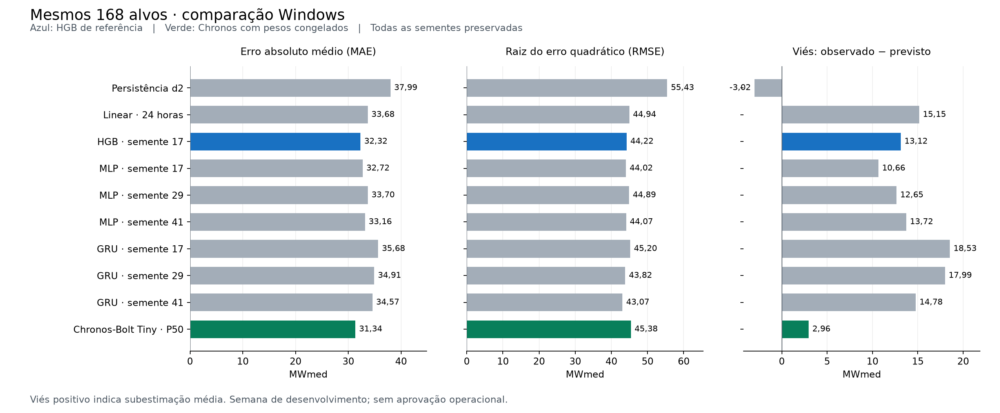
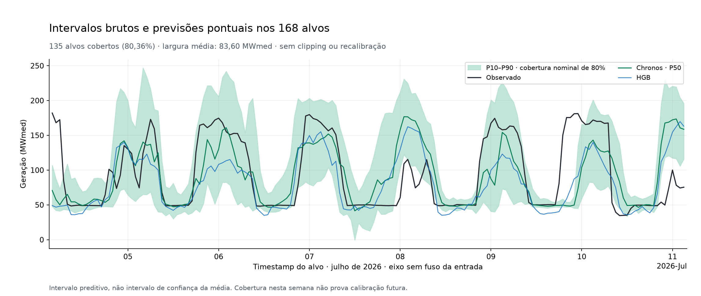

# Parecer M09.3 — previsão pré-treinada e decisão de desenvolvimento

A execução Windows `20261117T213329Z_3b201a01` aplicou Chronos-Bolt Tiny
congelado às mesmas 168 origens dos baselines locais, sem reajustá-los.
O baseline reutilizado foi `20261115T170309Z_90a6625f`. Foram preservados
o contexto de 24 medições, o horizonte h24 e o atraso assumido de duas horas.

## Alinhamento e significado da previsão

Na origem de 03/07/2026 às 04h, o histórico termina às 02h; o alvo é
04/07/2026 às 04h. A distância entre a última medição e o alvo é **26 horas**.
O primeiro passo previsto corresponde a 03/07 às 03h, portanto o passo
26 ocupa o índice Python **25**. O passo 24 apontaria para 04/07 às 02h,
duas horas antes do alvo correto.

A função calcula essa distância por exemplo e seleciona P10/P50/P90 nos
eixos `[batch,quantil,passo]`. O teste com lead de cinco horas impede tratar
26/25 como constantes universais. P50 foi prescrito como previsão pontual
antes de examinar os erros. A trajetória completa `[168,9,26]` foi preservada;
os nove quantis não são nove amostras aleatórias.

A M09.2 examinou representações de um encoder–decoder não treinado, com
seis slots sintéticos sem correspondência automática a seis horas. Nesta
etapa, os 8.652.672 parâmetros pré-treinados produzem quantis futuros por
uma cabeça de saída própria. O contexto entra em MWmed e recebe a
normalização interna do modelo, sem aplicar os normalizadores por lag da MLP.
A revisão fixa é `a0e552de83495b5c28c14c71c374f3e33280b340`; o
[código oficial 1.5.3](https://github.com/amazon-science/chronos-forecasting/blob/v1.5.3/src/chronos/chronos_bolt.py)
documenta a interface de quantis diretos usada no experimento.

## Comparação pareada

Métricas em MWmed nas mesmas 168 origens:

| Método | Semente | MAE | RMSE | Viés observado − previsto |
|---|---:|---:|---:|---:|
| Persistência d2 | — | 37,991646 | 55,434342 | −3,016872 |
| Linear 24h | — | 33,678664 | 44,938111 | +15,148681 |
| HGB 24h | 17 | 32,323956 | 44,221683 | +13,119039 |
| MLP 24h | 17 | 32,724828 | 44,019866 | +10,655947 |
| MLP 24h | 29 | 33,700811 | 44,892316 | +12,652757 |
| MLP 24h | 41 | 33,159788 | 44,069511 | +13,724280 |
| GRU 24h | 17 | 35,675970 | 45,200733 | +18,525120 |
| GRU 24h | 29 | 34,911227 | 43,816199 | +17,993098 |
| GRU 24h | 41 | 34,573202 | 43,066020 | +14,777710 |
| Chronos-Bolt Tiny P50 | — | **31,340738** | 45,380136 | +2,962412 |

Todas as sementes permanecem na tabela. O candidato reduziu o MAE do HGB
Windows de 32,323956 para 31,340738: ganho de **3,041763%**, ou
0,983218 MWmed de redução média do erro absoluto. Teve erro absoluto menor
em 95 das 168 origens. Esses números não substituem o HGB local pelo
resultado Linux de outro pacote.

O viés positivo indica subestimação média: caiu de +13,119039 no HGB para
+2,962412 no Chronos, mas não foi eliminado. Em contrapartida, o RMSE
piorou de 44,221683 para 45,380136. A GRU 41 também tem RMSE menor,
43,066020, embora seu MAE seja maior. O desempenho depende do critério;
a redução de MAE não demonstra melhora uniforme dos erros grandes.

## Intervalos preditivos brutos

O intervalo nominal de 80%, entre P10 e P90, incluiu **135 de 168 alvos**:
cobertura observada de **80,357143%**. Vinte alvos ficaram abaixo de P10
e treze acima de P90. A largura média foi **83,595237 MWmed**.
Não houve cruzamentos entre os três quantis selecionados nem P50 negativo;
não se aplicaram clipping, ordenação corretiva ou recalibração.

São intervalos preditivos, não intervalos de confiança da média. Cobertura
agregada próxima do nominal numa semana não prova calibração condicional
ou estabilidade futura. A largura e as perdas pinball/interval score
registradas devem acompanhar a cobertura; cobrir por meio de intervalos
amplos não resolve sozinho a utilidade da previsão.

## Custo e decisão

A carga do modelo levou **0,174339 s**, o aquecimento **0,024015 s** e a
inferência dos lotes das 168 origens **0,198840 s**, com até 16 contextos
por lote e dois threads de CPU. Instalação e download ficaram fora desses
tempos. O pico de **397,292969 MiB** pertence ao processo inteiro, incluindo
bibliotecas e dados, sem isolar o modelo. A latência de inferência dos
baselines não foi medida nesta execução; seus tempos de treino não são
comparadores válidos para esse custo.

Mantenho Chronos-Bolt Tiny como **candidato de desenvolvimento por MAE** e
redução do viés, preservando o HGB como referência. A piora do RMSE exige
examinar os casos de maior erro e o custo da decisão atendida. A comparação
não estabelece superioridade estatística nem autoriza promoção à produção.

Esta semana já foi examinada no desenvolvimento, as origens têm dependência
temporal e a sobreposição com o corpus de pré-treino não foi verificada.
Fuso físico e disponibilidade real continuam pressupostos do protocolo.
A próxima decisão exige períodos adicionais e critérios fixados antes de
observá-los, sem reutilizar esta semana como teste final intocado.

## Evidências

[Guia passo a passo](../docs/Explicacao_M09_3_Passo_a_Passo.md) e
[função de alinhamento](../notebooks/m09_alinhamento_autoral.py).
Execução: [protocolo](transformer/CJU_BA5EIGT/m09_3_pre_treinado/20261117T213329Z_3b201a01/protocol.json),
[resultado](transformer/CJU_BA5EIGT/m09_3_pre_treinado/20261117T213329Z_3b201a01/resultado.json),
[resumo](transformer/CJU_BA5EIGT/m09_3_pre_treinado/20261117T213329Z_3b201a01/summary.csv),
[alinhamento](transformer/CJU_BA5EIGT/m09_3_pre_treinado/20261117T213329Z_3b201a01/alinhamento_alvos.csv),
[comparação pareada](transformer/CJU_BA5EIGT/m09_3_pre_treinado/20261117T213329Z_3b201a01/comparacao_pareada.csv),
[métricas dos quantis](transformer/CJU_BA5EIGT/m09_3_pre_treinado/20261117T213329Z_3b201a01/quantile_metrics.json)
e [relatório HTML](transformer/CJU_BA5EIGT/m09_3_pre_treinado/20261117T213329Z_3b201a01/relatorio.html).

[Conferência independente dos arquivos e métricas](../docs/evidencias_m09_3_local/auditoria_resultados.json),
[registro dos comandos executados](../docs/evidencias_m09_3_local/registro_execucao.json) e
[testes do alinhamento](../tests/test_m09_alinhamento_autoral.py).
