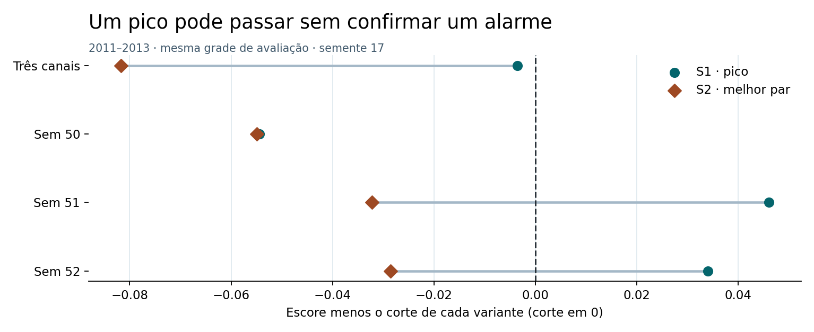

# Satellite Anomaly Monitor

Investigação de como transformar escores de telemetria em alarmes verificáveis por evento, usando dados da Agência Espacial Europeia (ESA).

Três sensores não formam automaticamente uma observação sincronizada, e um escore alto não garante um evento detectado. O projeto compara detectores, congela uma política de confirmação e investiga por que ela deixa de emitir alarmes em outro período. Pode interessar a profissionais de Data Science, Analytics e monitoramento que precisam avaliar a transferência de uma regra antes de adotá-la.

O recorte usa os canais anonimizados 50–52 da Mission1 v2: ajuste em 2004–2007, desenvolvimento em 2008–2010 e teste em 2011–2013. A grade é de 15 minutos; medições com mais de 180 segundos são invalidadas. A curadoria do ajuste é retrospectiva, e UTC e disponibilidade no instante da medição são hipóteses do estudo.



*Diagnóstico de 2011–2013, semente 17. Eixo horizontal: escore menos corte, adimensional; zero é o corte próprio de cada variante. S1 é o pico utilizável; S2, o maior mínimo de dois escores consecutivos utilizáveis. Figura de referência preservada, com os valores conferidos contra a execução Windows `20261124T152509Z_3878d5e2`; [origem e conferência](docs/REPRODUCAO.md).*

1. **Um ranking favorável no desenvolvimento não resolve a escolha de alarme.** Na execução Windows `20261119T101049Z_253ff59f`, a precisão média (*Average Precision*, AP) por instante foi maior para Isolation Forest. AP mede o ranking; não é acurácia nem probabilidade. [Métricas e recibo](reports/m10_2/20261119T101049Z_253ff59f/resultado.json).

   | Detector — desenvolvimento 2008–2010 | AP |
   | --- | ---: |
   | Isolation Forest | 0,758149 |
   | Escore robusto | 0,716427 |
   | Análise de Componentes Principais (PCA) | 0,502013 |
   | Constante | 0,037214 |

2. **A política congelada falhou na transferência temporal.** O run `20261123T195301Z_332fb306` escolheu Isolation Forest, corte 0,7199442558 e duas confirmações consecutivas somente no desenvolvimento. Ali detectou 3/8 IDs, com 15 inícios; no teste 2011–2013 detectou **0/8**, com zero inícios. Precisão e atraso no teste são indefinidos. O maior escore, 0,7164359651, já era inferior ao corte. [Política](reports/m10_3/20261123T195301Z_332fb306/politica_congelada.json) e [resultado](reports/m10_3/20261123T195301Z_332fb306/resultado.json).

3. **Retirar um canal criou picos, mas não recuperou a confirmação.** No diagnóstico Windows `20261124T152509Z_3878d5e2`, sem o canal 52 e com semente 17, quatro pontos atingiram o corte próprio de 0,7201268845, mas S2 ficou em 0,6915642217: nenhum par confirmou um início. As 12 combinações de quatro variantes e três sementes permaneceram em 0/8 IDs no período já examinado. [Métricas de ablação](docs/evidencias_readme/m10_4_windows_metricas_ablacao.csv) e [recibo](docs/evidencias_readme/m10_4_windows_resultado.json), copiados sem alteração do run. Esse diagnóstico não reclassifica o teste como avaliação inédita.

Como foi feito:

- Sincronizar somente amostras anteriores ou iguais ao instante de decisão e preservar lacunas e idade da medição.
- Ajustar escala e detectores no período histórico, com curadoria explicitada.
- Separar ranking por instante, início confirmado e crédito por ID anotado.
- Escolher e registrar a política no desenvolvimento antes de avaliar o teste.
- Retirar canais mantendo as mesmas linhas de ajuste, instantes e IDs, sem reajustar parâmetros pelo diagnóstico.

Para reproduzir, use a raiz do repositório, o ambiente Python 3.12 preparado e as entradas indicadas no [guia de reprodução](docs/REPRODUCAO.md). A primeira chamada confere somente a função; a segunda ajusta 11 florestas pequenas e grava outro run, sem download ou Docker:

```powershell
conda activate renewable-forecast
python satellite-anomaly-monitor/scripts/executar_m10_4.py --verificar
python satellite-anomaly-monitor/scripts/executar_m10_4.py
```

O comando usa a função de referência; os resultados Windows citados usaram a implementação assistida registrada. O guia distingue o run local, as cópias leves de evidência e os arquivos necessários ao clone.

Os canais não têm semântica física pública. As anotações não garantem completude; três sementes não são três períodos independentes. O próximo passo verificável é fixar outra janela temporal e seus critérios antes da avaliação, preservando estes resultados e a política. Não há homologação operacional.

Críticas sobre exposição, anotação, confirmação ou desenho da próxima avaliação são bem-vindas, especialmente quando acompanhadas do run e da linha de evidência. Fonte: **ESA Anomaly Dataset, Mission1 v2**, [DOI 10.5281/zenodo.15237121](https://doi.org/10.5281/zenodo.15237121); a proveniência local registra atribuição à ESA e licença CC BY 3.0 IGO dos dados. Projeto de Marlon A. Bomfim, com assistência de Codex na implementação, análise e redação registrada nas entregas.
