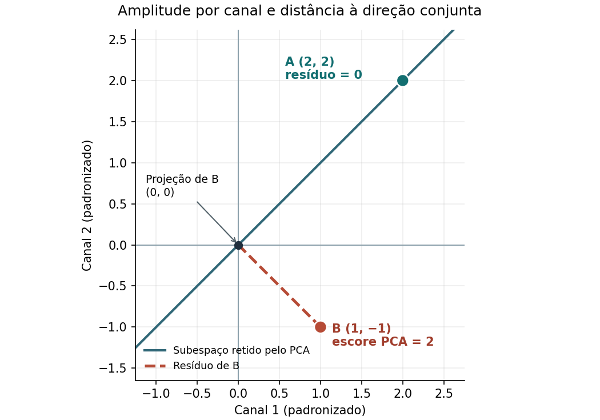

# Aula 2 — PCA: um comportamento improvável pode caber na faixa de cada sensor

**Problema.** Se dois sensores costumam caminhar juntos, `z_A = (2, 2)` pode representar uma mudança forte na direção usual. `z_B = (1, −1)` tem valores menores, mas respeita menos a relação aprendida. Vamos separar **amplitude em cada canal** de **distância à estrutura conjunta**.

## 1. De covariância a uma base menor

Após padronizar com a mediana e o MAD do ajuste, empilhe as linhas em \(Z\in\mathbb R^{n\times p}\). A média das linhas de \(Z\), denotada por \(\mu\), geralmente não é zero: centralizar pela mediana não é centralizar pela média. O PCA atualiza esse centro na etapa de ajuste, também só com dados históricos.

Se \(Z_c=Z-\mu\), a matriz de covariância amostral é \(C=Z_c^\top Z_c/(n-1)\). A variância ao longo de um vetor unitário \(w\) é \(w^\top Cw\). Escrevendo \(w\) na base ortonormal dos autovetores de \(C\), essa quantidade vira a soma dos autovalores ponderados pelos quadrados das coordenadas de \(w\); os pesos somam 1. O maior valor é obtido na direção do maior autovalor. As demais seguem na ordem e são ortogonais. Na implementação o PCA usa SVD da matriz centrada; o resultado geométrico é o mesmo.

Por exemplo, para a covariância

\[
\begin{bmatrix}1 & 0{,}98\\0{,}98 & 1\end{bmatrix}
\]

as direções \((1,1)/\sqrt2\) e \((1,-1)/\sqrt2\) têm variâncias 1,98 e 0,02. A diagonal retém 99% da variância. Se um ponto se desviar da diagonal, a maior parte dessa diferença fica no componente que jogamos fora. É esse resíduo que usaremos como escore, ainda que o ponto tenha escores baixos em cada canal.

## 2. Projeção, reconstrução e resíduo

Em scikit-learn `components_` é uma matriz \(W\) de shape `[k, p]`: **cada linha é uma direção**. Para os \(n\) pontos em espaço padronizado:

\[
T=(Z-\mu)W^\top,\quad \widehat{Z}=TW+\mu,\quad
S_{\mathrm{pca},i}=\sum_{j=1}^{p}(Z_{ij}-\widehat{Z}_{ij})^2.
\]

| Operação | Formato | Leitura |
| --- | --- | --- |
| Centralizar | `[n, p]` | Mover a origem para o centro usado no ajuste. |
| Multiplicar por `W.T` | `[n, k]` | Obter uma coordenada por componente retido. |
| Multiplicar por `W` e somar o centro | `[n, p]` | Voltar ao espaço dos canais; as direções descartadas não voltam. |
| Somar os resíduos ao quadrado por linha | `[n]` | Medir a energia que ficou fora do plano. |

**Conta manual com centro zero e uma direção diagonal.** Para A, \(T_A=2\sqrt2\); a reconstrução devolve (2,2), então o resíduo é zero. Para B, \(T_B=0\); a reconstrução é (0,0), então \(S_B=1^2+(-1)^2=2\). O ranking robusto era A (2) antes de B (1); o PCA dá o contrário. Os exemplos ilustram **pontos**; não são telemetria real.



O escore não é a coordenada da primeira componente e não é a porcentagem de variância retida. Um ponto muito longe **ao longo** da direção aprendida tem resíduo baixo. Com todos os componentes de uma base ortonormal, a projeção é a identidade e o resíduo fica zero salvo arredondamento, inclusive para um ponto extremo.

No recorte real de três canais, o protocolo fixa **dois** componentes. A referência retém cerca de **99,56%** da variância do ajuste. Isso não transforma o PCA em melhor detector; é uma propriedade dos dados usados no ajuste. O critério de ranking é outro. Uma relação anômala pode estar justamente em uma direção de baixa variância, mas uma anomalia de deslocamento conjunto pode ficar no plano e passar despercebida pelo resíduo.

## 3. Sua implementação

Crie `C:\renewable-forecast-lab\satellite-anomaly-monitor\notebooks\m10_2_pca_autoral.py` com `import numpy as np` e:

```python
def erro_pca_por_amostra(x, centro, componentes):
    """Devolve um vetor [n] com a soma dos resíduos quadráticos por linha."""
    # Implemente centralização, projeção, reconstrução e escore.
```

**Contrato:** `x` é a matriz padronizada `[n, p]`, `centro` é o vetor `[p]` do PCA ajustado, `componentes` tem shape `[k, p]` e linhas ortonormais. Você recebe dados válidos. Não faça `fit`, não recalcule a média na sua função, não altere os argumentos e não retorne `mean`, escore global ou erros por coluna. Sua função devolve uma distância quadrática para cada instante.

**Onde verificar sua própria lógica:** com `x=[[3, 1]]`, `centro=[1, 0]` e `componentes=[[0, 1]]`, a coordenada é 1, a reconstrução é `[1, 1]` e o resultado é `[4]`. Esse exemplo pega a omissão do centro: o ponto de partida do plano é `[1, 0]`. As duas conferências do runner usam outros casos, inclusive uma base rotacionada, retangular e dados somente leitura. O runner também compara o resultado autoral em toda a tabela real com `transform` e `inverse_transform`.

Não precisa executar dois comandos de verificação. Depois de ler a Aula 3, rode **uma vez** o modo `--autoria` que está em [Comece aqui](../COMECE_M10_2.md). O programa completo já funciona em modo normal caso queira examinar a referência. A função de referência está em `src/satmon/detectores_m10_2.py`; consultar depois da tentativa é uma forma de revisão, não evidência de solução independente.

Referência de interface: [PCA do scikit-learn](https://scikit-learn.org/stable/modules/generated/sklearn.decomposition.PCA.html). A biblioteca centra suas entradas; a padronização robusta usada nesta aula é uma etapa explícita anterior.
